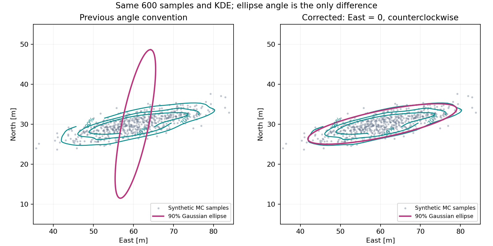

# 数学・物理検証（2026-10-17）

90%楕円とKDE等高線の向きが大きく異なる原因は、楕円の角度を「北から時計回り」で計算し、「東から反時計回り」で描画する経路が混在していたことでした。計算・地図・3D表示を東基準の反時計回りに統一しました。

## 再現と修正



これは実飛行の結果ではなく、乱数シード173・600点・標準偏差9 mと1.5 m・回転12°の合成データです。KDEは左右で同一です。旧式の角度は78.250°、修正後は11.750°となり、主軸が一致します。0・15・45・90・120・165°の別データでも検証しています。角度によっては旧式でも一致するため、必ず90°ずれる問題ではありません。

| 対象 | 確認した問題と対応 |
| --- | --- |
| 楕円の角度 | 最大固有値の固有ベクトルに対して `atan2(North, East)` を使用。`angle_convention: east_ccw` を記録し、初期計算と確率変更で同じ関数を使用 |
| 楕円の大きさ | 任意の確率pに対して軸倍率 `sqrt(-2 log(1-p))` を使用。表にない確率を90%扱いする挙動と、短軸を描画都合で膨らませる処理を解消 |
| KDEと散布点の表示 | 等間隔格子上の密度を累積して確率質量を求め、その閾値と同じ密度基準で点を選別。サンプル位置の密度を再び重みとして足す処理を解消 |
| KDEの格子 | 軸ごとの広がりとカーネル標準偏差から余白を設定。微小な着地分布が固定の余白に埋もれる問題を軽減 |
| CEP50円 | 公称着地点ではなく、半径の算出基準と同じMC着地点の平均を中心に表示 |
| Rパーセンタイル | Workerと確率変更の両方を線形補間の分位点に統一 |
| GO/NO-GO | CEP50の小ささではなく、目標円内の着地点数／全試行数を選択確率と比較。失敗試行は円外として扱い、成功点が4点未満ならGOにしない |
| 風ベクトル | 風が来る方向（FROM）からENUへの変換を統一。北風は負のNorth成分 |
| 保存済み結果 | 角度基準の記録がない旧楕円は、読み込み時に元の散布点から再計算。点が不足する場合は曖昧な楕円を非表示。再保存後は再変換しない |

KDEの等高線は密度の高い場所から所定の確率質量を囲む領域です。楕円は標本平均と標本共分散から当てはめた**2次元正規分布の確率領域**であり、平均値の信頼区間ではありません。非正規・複数ピークの分布では、正しく実装しても両者の形や向きは一致しない場合があります。また、楕円内に実サンプルのちょうど90%が入る保証もありません。

## 独立に確認した数式・物理量

`tests/core/test_math_physics_audit.py` は次を、解析式・数値積分・独立したSciPy分位点と比較します。

- 共分散の主軸と楕円境界のMahalanobis距離、KDE密度の共分散主軸。
- 1・50・68・75・90・93・99%のカイ二乗分位点、50,000点の正規分布に対する90%包含率（許容差0.5ポイント）。
- 同一点・一直線の分布でのゼロ軸と、特異なKDEの扱い。
- 等方2次元正規分布のKDE閾値がピーク密度の `1-p` 倍になること。
- 目標から外れた小さな分布、目標のオフセット、失敗試行を含む包含率。
- 東西南北の風向とENUの往復変換。
- 推力の台形積分による力積、`m_propellant = impulse / (Isp × g0)`、燃焼前後の質量収支。
- 質量加重重心、平行軸の定理と座標原点移動への不変性、円柱の慣性モーメント、薄い円錐殻の独立数値積分。
- 静水圧・一定気温減率モデルの気圧と高度の逆変換。
- 無風・非自転条件で発射方位を90°回転させた場合の軌道の回転対称性。

最後の対称性試験では、RocketPyが含む地球自転と積分誤差を分離しました。通常設定では着地成分に約0.058 mの差がありましたが、**テスト内だけ**地球自転を止め、`rtol=atol=1e-9, max_time_step=0.005 s` とすると約0.00000036 mまで縮小しました。製品の地球自転モデルや積分設定は変更していません。

`tests/ui_qt/test_result_menu.py` は実際のQtウィジェットとMatplotlibの描画オブジェクトを使い、地図と3D表示の楕円主軸、KDE境界、CEP円中心、90%から75%への変更、目標外・試行失敗時のNO-GOを確認します。`tests/utils/test_result_io.py` は旧結果の移行と再保存後の整合性を確認します。

## 残るモデル上の制約

以下は今回の統計・描画修正では変更していません。

1. **開傘は遅延時刻を厳密に再現していません。** `core/simulation.py` は上昇軌道から遅延時刻に対応する高度を取り、下降中にその高度へ戻った時点で開傘します。遅延が頂点到達より後の場合は頂点高度へ丸められます。早すぎる噴出や頂点後の遅い開傘を忠実に再現するには、時間・イベントによる展開モデルへの変更が必要です。高速MCも公称計算の開傘高度を再利用します。
2. **モーターの内部形状・慣性は近似です。** 比推力から推進薬質量を推定し、仮定したグレイン形状などを使います。上記の質量収支試験はモデル内の整合性の確認であり、実モーターの寸法・搭載適合性や実測CGを検証するものではありません。
3. **風と空力のモデル誤差は別に残ります。** 高度方向の風補間・外挿、抗力係数、CP補正などの妥当性は実測値との比較が必要です。全フィン形状や全飛行条件を物理的に検証したものではありません。
4. **GOは有限回のMCによる経験的な判定です。** 真の着地確率の信頼下限ではありません。楕円・KDEは成功した試行の分布で、失敗試行を含むGO判定の分母とは異なります。Phase Bの風変動許容幅も簡易な監視基準であり、「2σだから2次元で95%」という保証はありません。

## 再実行

今回の全体実行結果は **196 passed、52 subtests passed**（127.29秒、警告18件）でした。

```powershell
python -B -X utf8 -m pytest -q
```

通常のテストは外部通信を必要としません。Qt描画はオフスクリーンで検証します。これらはソフトウェアの回帰・数式整合性の試験であり、実飛行データによる精度検証は含みません。

角度の仕様は[Matplotlib Ellipse](https://matplotlib.org/stable/api/_as_gen/matplotlib.patches.Ellipse.html)、比較に使う分布は[SciPy chi2](https://docs.scipy.org/doc/scipy/reference/generated/scipy.stats.chi2.html)、KDEは[SciPy gaussian_kde](https://docs.scipy.org/doc/scipy/reference/generated/scipy.stats.gaussian_kde.html)を参照しています。
